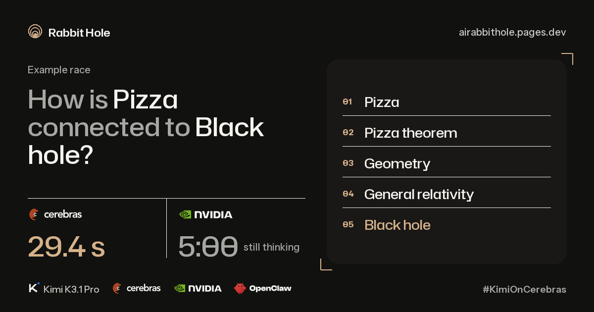

# Rabbit Hole

**The Wikipedia game, but an AI plays it.** Ask how any two things are connected ("How is Pizza
connected to Black holes?") and watch an AI agent click through real Wikipedia articles, link by
link, until it gets there. The same model races itself on two kinds of hardware at once:
**Cerebras** vs **NVIDIA GPUs**.

**Live:** [airabbithole.pages.dev](https://airabbithole.pages.dev) ·
Built for the [Cerebras × Kimi hackathon](https://luma.com/cerebras-kimi-hackathon?tk=F5e3mX) · #KimiOnCerebras



```
Pizza → Pizza theorem → Geometry → General relativity → Black hole
Kimi K3.1 Pro on Cerebras: 29.4 s.   Same model on GPUs: still thinking at 5 minutes.
```

## What it does

- **Pick a model.** The home page lists the models Cerebras serves (Kimi K3.1 Pro, GPT-OSS 120B,
  Qwen 3.8 27B), read live from `/api/models`. Every model stays selectable: one Cerebras is not serving shows a "system down" page with a
  one-click switch to a working model. GPT-OSS 120B is switched off for now: the free key allows it only
  5 requests a minute, too few for a race.
- **NVIDIA lane for every model.** NVIDIA's free tier serves only Kimi K3.1 Pro, so for Qwen and
  GPT-OSS the NVIDIA lane runs a random NVIDIA-hosted model (Nemotron 3.5 Lightning, Nemotron 3 Ultra,
  MiniMax M3.1 Flash or Step 5 Preview: the ones that tool-call fast enough). Every screen names it
  as a different model, and these mixed races are left out of the "time saved by Cerebras" stat.
  Each one is its own OpenClaw agent (`racer-nv-*`), so both lanes pay the same agent overhead.
- **Two lanes, one model.** For Kimi K3.1 Pro both lanes run the same model. Only the inference hardware differs:
  Cerebras on one side, NVIDIA GPUs on the other. Clocks are real elapsed time.
- **Where the GPU number comes from.** The GPU lane uses the **free tier of NVIDIA's API catalog**
  (build.nvidia.com), and the site labels it that way. On the free tier, a request often waits
  3-4 minutes in NVIDIA's queue before the first token, so the GPU time is real but includes that
  queue; it is not a measurement of what a paid GPU host would do. Swapping in a paid GPU host
  (for example through Vercel AI Gateway) is one line in `server.py`'s `lanes()`.
- **Every click is a real link.** On each page the agent sees the article's body links and picks
  one with a one-line reason (and an optional "thinking note"). The rules are enforced in code,
  not by the model: only links on the current page, no page twice, and if the target is linked
  from the current page the agent clicks it straight away ("direct link").
- **A story at the end.** When the first lane wins, Kimi turns the chain into a 3-sentence story,
  so the answer reads like an insight, not a list.
- **Replays.** Every race is saved and can be replayed exactly as it happened (1×, 2×, 5×,
  scrubbing, shareable links like `/?replay=<id>`). Busy or rate-limited visitors get a replay
  instead of a dead end.
- **Built to be shared.** Post on X with a ready-made post, a downloadable share image, and link
  previews generated per race (title, description and a 1200×630 image with the chain, both times
  and the brand logos).
- **Live topic checks.** The From/To fields suggest real articles as you type, confirm valid ones,
  offer "Did you mean …?" for typos and a picker for ambiguous names (Mercury → planet, element,
  mythology). This uses Wikipedia's own search straight from the browser: no AI tokens.
- **Little extras.** A fast 3-2-1 countdown, a hall of fame (fastest find, deepest rabbit hole,
  most waiting saved), "Surprise me" with 150+ well-known topics from 12 different worlds, and a
  running "waiting saved by Cerebras" odometer.

## How it works

```
 Browser (single HTML page, mobile first)
    │  live race over server-sent events, replays, share image (canvas)
    ▼
 Cloudflare Pages ─ static page + logos
    │  functions/api/[[path]].js   proxies /api/* to the race server (adds the visitor IP + a shared secret)
    │  functions/index.js          rewrites <head> per page: title, description, og:image for replays
    ▼
 Race server (FastAPI, backend/server.py) ─ one small VM, Docker
    │  race.py   two lanes in parallel, one model call per click, rules enforced in code
    │  wiki.py   MediaWiki API: body links, redirects, summaries, disambiguation (cached, polite UA)
    │  og.py     Pillow-drawn link-preview images from saved races
    ▼
 OpenClaw gateway (openclaw/) ─ two agents, caller-supplied go_to tool
    ├── racer-cerebras → Cerebras  (moonshotai-kimi-k3.1-pro-trial)
    ├── racer-nvidia   → NVIDIA API catalog (moonshotai/kimi-k3.1-pro)
    ├── racer-qwen / racer-gptoss → Cerebras (qwen-3.8-27b / gpt-oss-120b, Cerebras only:
    │                  no free GPU host serves them, so there is no same-model GPU lane)
    └── storyteller(-qwen, -gptoss) → Cerebras  (the 3-sentence story, same model as the race)
```

Each hop is one OpenAI-compatible chat call with a single `go_to(title, reason, thinking)` tool and
`tool_choice: "required"`. The server streams events (`lane_started`, `thinking`, `hop`,
`lane_done`, `lane_timeout`, `story`, …) to the page, and saves the whole event list so replays are
exact.

## Run it locally

```bash
cd backend
python3 -m venv .venv && . .venv/bin/activate
pip install -r requirements.txt
cp ../.env.example ../.env        # add CEREBRAS_API_KEY and NVIDIA_API_KEY
cp sample-runs/*.json runs/       # optional: a few past races to replay
uvicorn server:app --port 8030
```

Open http://localhost:8030. Without `OPENCLAW_URL` the server calls Cerebras and NVIDIA directly,
which is the quickest way to try it. To use OpenClaw like production, run a gateway with the config
in [`openclaw/`](openclaw/) and set `OPENCLAW_URL=http://127.0.0.1:18789/v1` plus
`OPENCLAW_GATEWAY_TOKEN`.

There is also a terminal runner for a single lane:

```bash
python cli.py kimi "Pizza" "Black hole"
```

## Deploy

**Race server (any small Linux box with Docker):**

```bash
docker build -f deploy/Dockerfile -t rabbithole .
# put rabbithole.env (keys, OPENCLAW_URL=http://openclaw-rh:18789/v1) and openclaw-home/ next to deploy/run.sh
./deploy/run.sh
```

Put HTTPS in front of `127.0.0.1:8031` (see [`deploy/Caddyfile.example`](deploy/Caddyfile.example);
`flush_interval -1` keeps the live stream flowing).

**Front end (Cloudflare Pages, free plan):** set the `RH_ORIGIN` secret to your race server's URL
and `RH_PROXY_SECRET` to the same value as in `.env`, then run
[`cloudflare/deploy.sh`](cloudflare/deploy.sh).

## Configuration

| Variable | What it does |
|---|---|
| `CEREBRAS_API_KEY`, `NVIDIA_API_KEY` | Provider keys (never commit them) |
| `OPENCLAW_URL`, `OPENCLAW_GATEWAY_TOKEN` | Route both lanes through an OpenClaw gateway |
| `RH_PROXY_SECRET` | Lets the Pages proxy pass the real visitor IP for per-visitor limits |
| `RH_PER_IP_PER_HOUR` (4), `RH_DAILY_RACES` (120), `RH_GPU_DAILY` (40) | Limits that protect free credits |
| `RH_LANE_TIMEOUT` (300) | A lane is stopped after this many seconds |
| `RH_ORIGIN`, `RH_SITE` (Cloudflare) | Race server URL; public site URL for link previews |

Touch `backend/REPLAY_ONLY` to switch the site to replays instantly. It also switches itself on if
the Cerebras key stops working.

## Things we learned the hard way

- **Agent harness timeouts.** OpenClaw gives up on a model that stays silent for 120 s by default.
  The free NVIDIA endpoint often takes longer than that before its first token, so the GPU lane
  kept failing with a "500" after 4 minutes. Fix: `models.providers.nvidia.timeoutSeconds: 295`.
- **Be gentle with shared endpoints.** Cerebras hackathon capacity was busy (HTTP 429 "queue
  exceeded"); retries back off with jitter instead of hammering.
- **Wikipedia wants a descriptive User-Agent** and throttles anonymous clients, so pages are cached
  and both lanes share one request per page.
- **Check before you make people wait.** When the shared Cerebras endpoint is full, OpenClaw keeps
  retrying inside a single call, so a race used to sit silent for 5 minutes. Now every race starts
  with a quick system check (agent gateway up, Cerebras answering), each fast-lane call is capped at
  45 s, and if the Cerebras lane fails the whole race stops early with an honest message. Races
  where Cerebras never finished are kept on the server but hidden from the public list.
- **Surprise pairs that are surprising but reachable.** `backend/make_pairs.py` searches Wikipedia's
  link graph for well-known topics from different worlds that are exactly two clicks apart.
- **Crawlers don't run JavaScript.** Link previews and SEO tags are written into the HTML by a Pages
  Function, not by the page script.

## Ideas to pick up

Looking for something to build? These are open and would make Rabbit Hole better. Issues and PRs
are welcome.

**Gameplay**
- **Beat the AI:** let a visitor play the same pair by clicking through Wikipedia themselves, with a
  timer, and compare their path and time with Kimi's.
- **Optimal path oracle:** compute the true shortest path (BFS over a Wikipedia link dump or an API
  crawl) and show how close the AI got.
- **Race of the day:** one featured pair every day with a countdown, an archive and streaks.
- **Checkpoint / marathon mode:** the agent must pass through checkpoints on the way.
- **More languages:** run races on other Wikipedias (de, fr, hi, ja, …).

**Models and speed**
- **More lanes:** any OpenAI-compatible endpoint (other providers, other models) as extra lanes,
  or a "model vs model" mode on the same chip.
- **Live reasoning:** stream the model's reasoning into the lane as it thinks.
- **Cost and tokens:** show tokens per second, tokens used and cost per race per lane.

**Product**
- **Rabbit Hole map:** draw the winning chain as a glowing path across a constellation of
  articles (designed in [`docs/DESIGN-BRIEF.md`](docs/DESIGN-BRIEF.md), not built yet).
- **Leaderboards:** fastest and shortest paths per pair, global and personal.
- **Embeds and bots:** an embeddable widget, and Discord/Slack/X bots that race a pair on request
  and reply with the share image.
- **Video export:** a one-click 60-second race video (Remotion or HyperFrames over a real recording).

**Engineering**
- **Storage:** move saved races from JSON files to SQLite/Postgres or D1.
- **Tests:** unit tests for the race rules and the Wikipedia link parser, plus a fake provider for CI.
- **One-command dev setup:** a `docker compose` file that runs the server and an OpenClaw gateway together.
- **Accessibility and i18n pass** over the whole UI.

## Contributing

1. Fork and clone, then run it locally (above). `sample-runs/` gives you replays without any API keys.
2. Keep the page a single dependency-free HTML file (`web/index.html`); the server is plain FastAPI.
3. Open a PR with a short description and a screenshot or replay link for UI changes.

## Credits

- Built with **Claude**. Design by Claude Design ([handoff and mockups](docs/design/)).
- **Kimi K3.1 Pro** by Moonshot AI, served by **Cerebras** and the **NVIDIA** API catalog.
- Agent harness: **OpenClaw**. Logos: [@lobehub/icons](https://lobehub.com/icons).
- Article text and links: **Wikipedia** (CC BY-SA 4.0). Fonts: Hubot Sans and Instrument Sans (OFL).

## License

[MIT](LICENSE)
